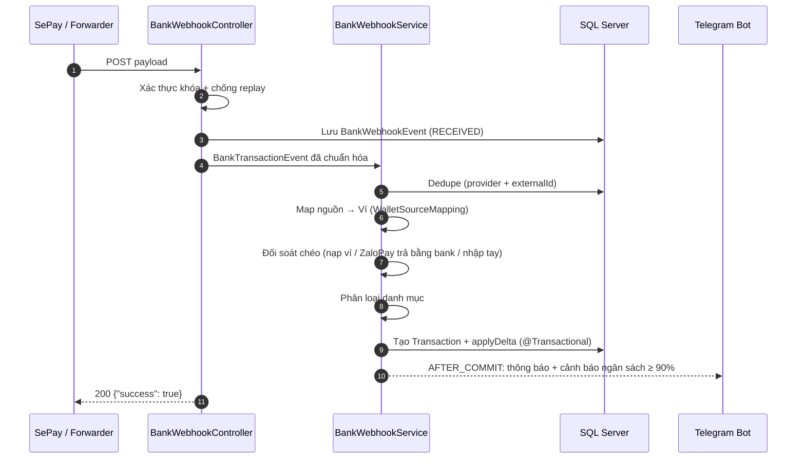

# 🏦 Kế hoạch tích hợp Webhook Biến Động Số Dư (Giai đoạn 3) – Phương án Kết hợp

> **Phạm vi**: Ngân hàng (VCB / MB / TCB…) qua **SePay** + Ví **ZaloPay** qua **chuyển tiếp thông báo Android**.
> Kiến trúc dạng *Strategy* để sau này thêm provider khác (MoMo, Casso…) mà không đụng tới lõi xử lý.

---

## 1. Kiến trúc tổng thể

```mermaid
flowchart LR
    subgraph Sources["Nguồn dữ liệu"]
        Bank["Ngân hàng VCB/MB/TCB"]
        Zalo["App ZaloPay (Android)"]
    end

    Bank --> SePay["SePay"]
    Zalo --> Forwarder["MacroDroid / Tasker\n(đọc thông báo đẩy)"]

    SePay -->|"POST /webhooks/bank/sepay\nAuthorization: Apikey"| Tunnel["ngrok / Cloudflare Tunnel"]
    Forwarder -->|"POST /webhooks/bank/notification\nX-Webhook-Key + X-Timestamp"| Tunnel

    Tunnel --> Ctrl["BankWebhookController"]
    Ctrl --> Verifier["Verifier theo provider"]
    Verifier --> Adapter["Adapter: chuẩn hóa → BankTransactionEvent"]
    Adapter --> Svc["BankWebhookService"]
    Svc --> Recon["Đối soát chéo nguồn\n(nạp ví, trùng, chuyển nội bộ)"]
    Recon --> Classifier["Phân loại danh mục"]
    Classifier --> DB[("SQL Server")]
    DB --> Notifier["Telegram Notifier (AFTER_COMMIT)"]
```



### Luồng xử lý 1 sự kiện



---

## 2. Bạn cần chuẩn bị (ngoài code)

| # | Hạng mục | Chi tiết |
|---|---|---|
| 1 | **Tài khoản SePay** | Liên kết các TK ngân hàng → tạo Webhook, chọn xác thực **API Key**, URL = `https://<public-url>/webhooks/bank/sepay` |
| 2 | **URL công khai** | `cloudflared tunnel` (miễn phí, URL cố định nếu có domain) hoặc `ngrok` (URL đổi mỗi lần chạy nếu dùng gói free) |
| 3 | **Điện thoại Android** cài ZaloPay + **MacroDroid** (hoặc Tasker) | Cấp quyền *Notification Access*, tắt tối ưu pin cho app chuyển tiếp |
| 4 | **Mẫu thông báo ZaloPay thực tế** | Chụp/copy 5–10 thông báo: thanh toán, nhận tiền, chuyển tiền, nạp ví, rút ví, hoàn tiền → để viết parser chính xác |
| 5 | **Danh sách ánh xạ nguồn → ví** | Số TK VCB → ví "Vietcombank", `com.vng.zalopay` → ví "ZaloPay"… (tạo ví ZaloPay trong app nếu chưa có) |

> [!IMPORTANT]
> Notification forwarding phụ thuộc điện thoại: cần bật mạng, không bị hệ điều hành kill app nền. Sự kiện mất trong lúc offline sẽ không được gửi lại → có cơ chế đối soát số dư định kỳ qua Telegram để phát hiện lệch.

---

## 3. Hợp đồng dữ liệu (Payload Contracts)

### 3.1. SePay → `POST /webhooks/bank/sepay`
Header: `Authorization: Apikey <SEPAY_API_KEY>`
```json
{
  "id": 92704,
  "gateway": "Vietcombank",
  "transactionDate": "2026-10-23 14:02:37",
  "accountNumber": "0123499999",
  "code": null,
  "content": "HIGHLANDS COFFEE 50000",
  "transferType": "out",
  "transferAmount": 50000,
  "accumulated": 19077000,
  "referenceCode": "MBVCB.3278907687",
  "description": ""
}
```
Phản hồi bắt buộc: HTTP `200` + `{"success": true}` (nếu không SePay sẽ retry).

### 3.2. Notification Forwarder → `POST /webhooks/bank/notification`
Header: `X-Webhook-Key: <NOTIFY_KEY>`, `X-Timestamp: <epoch giây>`
```json
{
  "app": "com.vng.zalopay",
  "title": "Thanh toán thành công",
  "text": "Bạn đã thanh toán 50.000đ cho Highlands Coffee",
  "postedAt": 1792740157000,
  "deviceId": "pixel-7"
}
```
- `externalId` = SHA-256(`app|title|text|postedAt`) → chống trùng khi Android bắn lại cùng 1 thông báo.
- Thiết kế generic theo `app` → sau này thêm MoMo (`com.mservice.momotransfer`) chỉ cần thêm parser.

---

## 4. Bảo mật

| Endpoint | Cơ chế |
|---|---|
| `/webhooks/bank/sepay` | So khớp `Apikey` bằng `MessageDigest.isEqual` (constant-time) |
| `/webhooks/bank/notification` | API key riêng + `X-Timestamp` lệch ≤ 5 phút (chống replay) + dedupe theo `externalId`. *(Nâng cao, tùy chọn: HMAC-SHA256 `X-Signature` nếu dùng Tasker JavaScriptlet)* |
| Chung | Thêm `/webhooks/bank/**` vào `PUBLIC_ENDPOINTS` (bỏ JWT), giới hạn kích thước body, không log khóa bí mật, trả `401` khi sai khóa |

---

## 5. Thay đổi trong code

### 5.1. Cấu hình (`application.properties`)
```properties
bank.webhook.enabled=true
bank.webhook.default-user-email=nghyqn1201@gmail.com
bank.webhook.sepay.api-key=...
bank.webhook.notification.api-key=...
bank.webhook.notification.allowed-apps=com.vng.zalopay
bank.webhook.replay-window-seconds=300
bank.webhook.match-window-minutes=10
bank.webhook.notify-telegram=true
```
→ [NEW] `config/BankWebhookProperties.java` (`@ConfigurationProperties("bank.webhook")`).

### 5.2. Entity & Repository

| File | Mô tả |
|---|---|
| [NEW] `entity/BankWebhookEvent.java` | Log mọi sự kiện: `provider`, `externalId`, `sourceKey` (số TK / package app), `direction` (IN/OUT), `amount`, `content`, `counterparty`, `bankBalance`, `occurredAt`, `rawPayload`, `status` (RECEIVED / PROCESSED / DUPLICATE / MATCHED / SKIPPED / UNPARSED / FAILED), `errorMessage`, `transactionId`. **Unique `(provider, external_id)`** |
| [NEW] `entity/WalletSourceMapping.java` | `provider` + `sourceKey` → `accountId`, `userId`. Bảng riêng vì một nguồn có thể là số TK ngân hàng **hoặc** package app |
| [NEW] `entity/BankCategoryRule.java` | Keyword → category (vd `HIGHLANDS`→101, `GRAB`→102, `LUONG`→201), có `priority`, `direction` |
| [NEW] 3 repository tương ứng | |

### 5.3. Tầng Provider (Strategy)

```
webhook/
├── BankWebhookProvider.java          (enum: SEPAY, NOTIFICATION)
├── BankTransactionEvent.java         (record chuẩn hóa chung)
├── verifier/
│   ├── BankWebhookVerifier.java      (interface)
│   ├── SePayVerifier.java
│   └── NotificationVerifier.java
├── adapter/
│   ├── BankPayloadAdapter.java       (interface)
│   ├── SePayPayloadAdapter.java
│   └── NotificationPayloadAdapter.java
└── parser/
    ├── NotificationParser.java       (interface, chọn theo package app)
    └── ZaloPayNotificationParser.java
```

`ZaloPayNotificationParser`: bộ regex theo mẫu thông báo thực tế → trích `amount`, `direction`, `counterparty`, `kind` (PAYMENT / RECEIVE / TRANSFER_OUT / TOP_UP / WITHDRAW / REFUND), `fundingSource` (số dư ví hay ngân hàng liên kết). Tái dùng `TelegramMessageParser.extractAmount` để đọc số tiền dạng `50.000đ`. Không khớp mẫu → `UNPARSED` + báo Telegram kèm nội dung gốc.

### 5.4. Tầng nghiệp vụ

| File | Trách nhiệm |
|---|---|
| [NEW] `services/BankWebhookService.java` | Điều phối: dedupe → map ví → đối soát chéo → phân loại → tạo `Transaction` + `accountService.applyDelta` trong 1 `@Transactional`; retry khi `OptimisticLockException` (do `Account.version`) |
| [NEW] `services/BankReconciliationService.java` | Logic đối soát chéo nguồn (mục 6) |
| [NEW] `services/BankTransactionClassifier.java` | (1) `BankCategoryRule` → (2) `TelegramMessageParser.detectCategory` (đổi `private` → `public`) → (3) fallback `OTHER_EXPENSE (112)` / `OTHER_INCOME (205)` |
| [NEW] `services/BankWebhookNotifier.java` | `@TransactionalEventListener(AFTER_COMMIT)` → Telegram: *"🏦 VCB −50.000đ · Highlands Coffee · 🍜 Ăn uống · Số dư: 19.077.000đ"*; tách logic cảnh báo ngân sách từ `TelegramCommandHandler` ra service dùng chung |
| [MODIFY] `TelegramMessageParser.java` | Mở `detectCategory` thành `public` |
| [MODIFY] `TelegramCommandHandler.java` | Tách `sendBudgetAlertsIfNeeded` sang service dùng chung (không đổi hành vi) |
| [MODIFY] `SecurityConfig.java` | Thêm `/webhooks/bank/**` vào `PUBLIC_ENDPOINTS` |

### 5.5. Controller

| Endpoint | Auth | Mô tả |
|---|---|---|
| `POST /webhooks/bank/sepay` | API Key | Nhận webhook SePay |
| `POST /webhooks/bank/notification` | API Key + timestamp | Nhận thông báo từ điện thoại |
| `GET /webhooks/bank/events?status=` | JWT | Lịch sử sự kiện (phân trang) cho Vue |
| `POST /webhooks/bank/events/{id}/reprocess` | JWT | Xử lý lại event `UNPARSED` / `SKIPPED` / `FAILED` |
| `GET/POST/DELETE /webhooks/bank/mappings` | JWT | Quản lý ánh xạ nguồn → ví |
| `GET/POST/DELETE /webhooks/bank/rules` | JWT | Quản lý quy tắc phân loại |

> [!NOTE]
> Các endpoint quản lý (JWT) cần nằm ngoài pattern public → public chỉ mở chính xác `/webhooks/bank/sepay` và `/webhooks/bank/notification`.

---

## 6. Đối soát chéo nguồn (phần quan trọng nhất)

Hai nguồn có thể cùng báo về **một** dòng tiền → phải tránh ghi trùng / sai bản chất.

| Tình huống | Nguồn bắn về | Xử lý |
|---|---|---|
| **Nạp tiền vào ZaloPay từ VCB** | SePay: VCB `out` 500k (nội dung chứa `ZALOPAY`/`NAP`) + ZaloPay: "Nạp tiền thành công 500k" | Ghép cặp (cùng số tiền, trong `match-window`) → tạo **1 transfer** VCB → ZaloPay (category `301`). Event còn lại → `MATCHED`. Nếu mới chỉ có 1 bên đến → chờ bên kia trong cửa sổ; quá hạn vẫn tạo transfer dựa trên rule nội dung |
| **Rút tiền ZaloPay về ngân hàng** | Ngược lại của trên | Transfer ZaloPay → VCB |
| **Thanh toán trong ZaloPay bằng nguồn ngân hàng liên kết** | SePay: VCB `out` "ZALOPAY…" + ZaloPay: "Thanh toán 50k cho Highlands" | Chỉ tạo **1 expense trên ví VCB**; dùng `counterparty` từ thông báo ZaloPay để **làm giàu mô tả + phân loại** (vì nội dung bank thường chỉ ghi chung "ZALOPAY") |
| **Thanh toán bằng số dư ví ZaloPay** | Chỉ ZaloPay | Expense trên ví ZaloPay |
| **Chuyển tiền giữa 2 TK ngân hàng của mình** (VCB → MB) | SePay `out` VCB + SePay `in` MB | Ghép cặp → 1 transfer `301` |
| **Đã nhập tay qua Telegram/Web trước đó** | Webhook đến sau | Cùng ví, cùng số tiền, ±10 phút, không có nguồn webhook → đánh dấu `MATCHED`, không tạo mới, báo Telegram "đã khớp với giao dịch nhập tay" |
| **Provider retry / Android bắn lặp** | Trùng `externalId` | `DUPLICATE`, trả 200 |
| **Nguồn chưa được ánh xạ** | — | `SKIPPED` + Telegram nhắc tạo mapping |
| **Lệch số dư** (`accumulated` của SePay ≠ `account.balance`) | — | Chỉ cảnh báo qua Telegram, không tự sửa |

> [!WARNING]
> Ghép cặp "chờ bên còn lại" cần một tác vụ định kỳ nhỏ (`@Scheduled` mỗi phút) để chốt các event đang `PENDING_MATCH` khi hết `match-window`.

---

## 7. Cấu hình MacroDroid (hướng dẫn sẽ viết kèm)
1. **Trigger**: *Notification Received* → App: ZaloPay.
2. **Action**: *HTTP Request* → `POST https://<public-url>/webhooks/bank/notification`, Content-Type JSON, body dùng biến `{not_title}`, `{not_text}`, `{not_app_package}`, timestamp `{system_time}`; header `X-Webhook-Key`, `X-Timestamp`.
3. Tắt tối ưu pin cho MacroDroid, bật *Keep alive*.

---

## 8. Kiểm thử
- **Unit test**: `SePayVerifier`, `NotificationVerifier` (sai key, timestamp hết hạn), `SePayPayloadAdapter`, `ZaloPayNotificationParser` (bộ mẫu thực tế), `BankTransactionClassifier`, `BankReconciliationService` (nạp ví, rút ví, trả bằng bank, chuyển nội bộ, trùng nhập tay), `BankWebhookService` (dedupe, chưa mapping).
- **Thủ công**: `curl` các payload mẫu vào `localhost:8080`; sau đó bật tunnel → nút *"Gửi webhook test"* của SePay + thanh toán thật 1 giao dịch nhỏ ZaloPay.
- Chạy toàn bộ `mvn test` để đảm bảo không ảnh hưởng test cũ.

---

## 9. Thứ tự triển khai

| Bước | Nội dung | Kết quả kiểm chứng |
|:---:|---|---|
| 1 | Properties, 3 entity + repository, Security | App khởi động, bảng được tạo |
| 2 | Strategy Verifier/Adapter + Controller cho **SePay** | `curl` → event được log |
| 3 | `BankWebhookService` (dedupe, mapping, tạo giao dịch, cập nhật số dư) | Giao dịch xuất hiện, số dư ví đúng |
| 4 | Classifier + Rule | Danh mục gán đúng |
| 5 | Telegram Notifier + cảnh báo ngân sách | Nhận tin nhắn Telegram |
| 6 | Provider **Notification** + `ZaloPayNotificationParser` | `curl` mẫu ZaloPay → giao dịch ví ZaloPay |
| 7 | `BankReconciliationService` + scheduler chốt ghép cặp | Nạp ví / trả bằng bank không bị ghi trùng |
| 8 | API quản lý (events, mappings, rules) + Swagger | Gọi được từ Swagger UI |
| 9 | Unit tests + hướng dẫn MacroDroid + cập nhật `project_road_map.md` | `mvn test` xanh |

---

## 10. Quyết định mặc định (có thể đổi)
- Endpoint không có tiền tố `/api/v1` để đồng bộ với các controller hiện có → `/webhooks/bank/...`
- **Tự động ghi** giao dịch rồi báo Telegram (có lệnh `/huy` sẵn để hoàn tác).
- Ánh xạ nguồn → ví bằng **bảng riêng** `wallet_source_mappings` (thay vì thêm cột vào `Account`), vì nguồn ZaloPay không có số TK ngân hàng.
