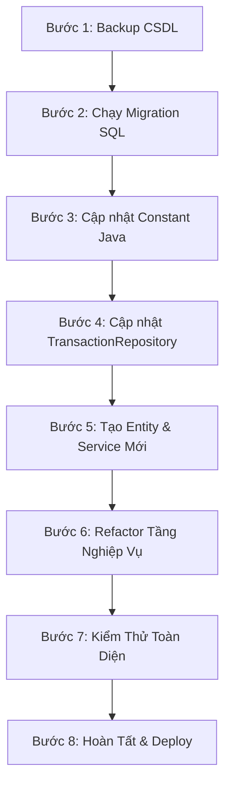

# 📊 Kế Hoạch Chuyển Đổi TransactionType & Category Sang Database (Phương Án Block ID Dạng Số)

> **Ngày cập nhật:** 2026-10-20  
> **Trạng thái:** Đã hoàn thành triển khai toàn bộ (Code + DB Migration)  
> **Định dạng ID:** Số nguyên (`INT`), phân dải theo Block `1xx`, `2xx`, `3xx`

---

## 1. Tổng Quan & Mục Tiêu

Hiện tại hệ thống đang hardcode **TransactionType** (3 giá trị: 0, 1, 2) và **Category** (19 giá trị: 1–19) dưới dạng hằng số `static final int` trong code Java.

### Hạn chế của hệ thống cũ:
- Giá trị `0` làm ID cho `TransactionType.EXPENSE` là bad practice trong CSDL (dễ nhầm với giá trị mặc định/null).
- Category bị chắp vá, nhảy cóc: `18 (TRAVELING)` và `19 (PRESENT)` là Chi tiêu nhưng bị nằm sau `16 (TRANSFER)` và `17 (SAVINGS)`.
- Không thể thêm/sửa/xóa danh mục tại runtime mà không sửa code, build và redeploy.
- Chưa hỗ trợ danh mục tùy chỉnh cho từng user và đa ngôn ngữ.
- Thiếu ràng buộc toàn vẹn khóa ngoại (Foreign Key) ở mức database.

### Quyết định kiến trúc (Phương án 1 - Block ID):
1. **Duy trì ID dạng số (`INT`)**: Không dùng `UUID` (quá cồng kềnh cho bảng từ điển vài chục dòng) hay `VARCHAR code` (tốn dung lượng, join chậm trên bảng hàng triệu giao dịch).
2. **Quy hoạch dải số khoa học**:
   - `TransactionType`: Bắt đầu từ `1` (`1: EXPENSE`, `2: INCOME`, `3: TRANSFER`).
   - `Category`: Phân block rõ ràng: Chi tiêu (`1xx`), Thu nhập (`2xx`), Khác (`3xx`).
3. **Ánh xạ 1-1 hai chiều**: Đảm bảo 100% dữ liệu cũ trong `transactions`, `budgets`, `recurring_transactions` được convert chính xác và an toàn.

---

## 2. Bảng Ánh Xạ ID: Cũ ➡️ Mới (Mapping Matrix)

### 2.1 TransactionType

| Constant | ID Cũ | ID Mới | Code | Tên hiển thị |
| :--- | :---: | :---: | :--- | :--- |
| `EXPENSE` | `0` | **`1`** | `EXPENSE` | Chi tiêu |
| `INCOME` | `1` | **`2`** | `INCOME` | Thu nhập |
| `TRANSFER` | `2` | **`3`** | `TRANSFER` | Chuyển khoản |

---

### 2.2 Category

| Nhóm | Constant | ID Cũ | ID Mới | Code | Tên tiếng Việt | Icon |
| :--- | :--- | :---: | :---: | :--- | :--- | :---: |
| **Chi tiêu**<br/>*(Dải 1xx)* | `FOOD` | 1 | **101** | `FOOD` | Ăn uống | 🍜 |
| | `TRANSPORT` | 2 | **102** | `TRANSPORT` | Di chuyển | 🛵 |
| | `ENTERTAINMENT` | 3 | **103** | `ENTERTAINMENT` | Giải trí | 🎮 |
| | `UTILITIES` | 4 | **104** | `UTILITIES` | Hóa đơn / Tiện ích | 💡 |
| | `HEALTHCARE` | 5 | **105** | `HEALTHCARE` | Sức khỏe | 💊 |
| | `EDUCATION` | 6 | **106** | `EDUCATION` | Học tập | 📚 |
| | `SHOPPING` | 7 | **107** | `SHOPPING` | Mua sắm | 🛍️ |
| | `HOUSING` | 8 | **108** | `HOUSING` | Nhà ở | 🏠 |
| | `DEBT` | 9 | **109** | `DEBT` | Sổ nợ (Trả nợ) | 💳 |
| | `TRAVELING` | 18 | **110** | `TRAVELING` | Du lịch | ✈️ |
| | `PRESENT` | 19 | **111** | `PRESENT` | Quà biếu / Tặng | 🎁 |
| | `OTHER_EXPENSE` | 10 | **112** | `OTHER_EXPENSE` | Chi tiêu khác | 📦 |
| **Thu nhập**<br/>*(Dải 2xx)* | `SALARY` | 11 | **201** | `SALARY` | Tiền lương | 💵 |
| | `BUSINESS` | 12 | **202** | `BUSINESS` | Kinh doanh | 💼 |
| | `INVESTMENTS` | 13 | **203** | `INVESTMENTS` | Đầu tư / Lãi | 📈 |
| | `GIFTS` | 14 | **204** | `GIFTS` | Thưởng / Quà | 🎁 |
| | `OTHER_INCOME` | 15 | **205** | `OTHER_INCOME` | Thu nhập khác | 💰 |
| **Khác**<br/>*(Dải 3xx)* | `TRANSFER` | 16 | **301** | `TRANSFER` | Chuyển khoản | 🔄 |
| | `SAVINGS` | 17 | **302** | `SAVINGS` | Tiết kiệm | 🏦 |

> [!TIP]
> **Ưu điểm vượt trội của dải số 1xx, 2xx, 3xx:**
> - Trong Java, kiểm tra nhóm chỉ cần một phép so sánh đơn giản:
>   - Là Chi tiêu: `categoryId >= 100 && categoryId < 200`
>   - Là Thu nhập: `categoryId >= 200 && categoryId < 300`
> - Dải `101 -> 199` còn trống tới hơn 80 số, thoải mái mở rộng thêm các danh mục chi tiêu sau này mà không bao giờ bị nhảy cóc.

---

## 3. Thiết Kế Bảng Database Mới (SQL Server)

```sql
-- 1. Bảng transaction_types
CREATE TABLE transaction_types (
    id          INT PRIMARY KEY,
    code        VARCHAR(50) NOT NULL UNIQUE,
    name        NVARCHAR(100) NOT NULL,
    created_at  DATETIME2 DEFAULT SYSUTCDATETIME()
);

-- Seed data: transaction_types
INSERT INTO transaction_types (id, code, name) VALUES
(1, 'EXPENSE',  N'Chi tiêu'),
(2, 'INCOME',   N'Thu nhập'),
(3, 'TRANSFER', N'Chuyển khoản');

-- 2. Bảng categories
CREATE TABLE categories (
    id                  INT PRIMARY KEY,
    transaction_type_id INT NOT NULL,
    code                VARCHAR(50) NOT NULL UNIQUE,
    name                NVARCHAR(100) NOT NULL,
    name_vi             NVARCHAR(100) NOT NULL,
    icon                NVARCHAR(10),
    is_system           BIT NOT NULL DEFAULT 1,
    is_active           BIT NOT NULL DEFAULT 1,
    display_order       INT DEFAULT 0,
    created_at          DATETIME2 DEFAULT SYSUTCDATETIME(),
    
    CONSTRAINT FK_category_type FOREIGN KEY (transaction_type_id) 
        REFERENCES transaction_types(id)
);

-- Seed data: categories
INSERT INTO categories (id, transaction_type_id, code, name, name_vi, icon, is_system, display_order) VALUES
-- Chi tiêu (1xx)
(101, 1, 'FOOD',          'Food',          N'Ăn uống',           N'🍜', 1, 1),
(102, 1, 'TRANSPORT',     'Transport',     N'Di chuyển',         N'🛵', 1, 2),
(103, 1, 'ENTERTAINMENT', 'Entertainment', N'Giải trí',          N'🎮', 1, 3),
(104, 1, 'UTILITIES',     'Utilities',     N'Hóa đơn / Tiện ích', N'💡', 1, 4),
(105, 1, 'HEALTHCARE',    'Healthcare',    N'Sức khỏe',          N'💊', 1, 5),
(106, 1, 'EDUCATION',     'Education',     N'Học tập',           N'📚', 1, 6),
(107, 1, 'SHOPPING',      'Shopping',      N'Mua sắm',          N'🛍️', 1, 7),
(108, 1, 'HOUSING',       'Housing',       N'Nhà ở',            N'🏠', 1, 8),
(109, 1, 'DEBT',          'Debt',          N'Sổ nợ',            N'💳', 1, 9),
(110, 1, 'TRAVELING',     'Traveling',     N'Du lịch',          N'✈️', 1, 10),
(111, 1, 'PRESENT',       'Present',       N'Quà biếu / Tặng',   N'🎁', 1, 11),
(112, 1, 'OTHER_EXPENSE', 'Other Expense', N'Chi tiêu khác',    N'📦', 1, 12),
-- Thu nhập (2xx)
(201, 2, 'SALARY',        'Salary',        N'Tiền lương',        N'💵', 1, 1),
(202, 2, 'BUSINESS',      'Business',      N'Kinh doanh',       N'💼', 1, 2),
(203, 2, 'INVESTMENTS',   'Investments',   N'Đầu tư / Lãi',    N'📈', 1, 3),
(204, 2, 'GIFTS',         'Gifts',         N'Thưởng / Quà',     N'🎁', 1, 4),
(205, 2, 'OTHER_INCOME',  'Other Income',  N'Thu nhập khác',    N'💰', 1, 5),
-- Chuyển khoản & Tiết kiệm (3xx)
(301, 3, 'TRANSFER',      'Transfer',      N'Chuyển khoản',     N'🔄', 1, 1),
(302, 1, 'SAVINGS',       'Savings',       N'Tiết kiệm',       N'🏦', 1, 2);
```

---

## 4. Script Chuyển Đổi Dữ Liệu CSDL Hiện Có (Data Migration Script)

Toàn bộ quá trình chuyển đổi dữ liệu được bao bọc trong một **Database Transaction** khép kín, sử dụng câu lệnh `CASE WHEN` để cập nhật đồng thời, ngăn chặn hoàn toàn lỗi ghi đè vòng tròn.

```sql
-- ============================================================================
-- SCRIPT MIGRATION DỮ LIỆU HIỆN CÓ SANG BỘ ID MỚI
-- ============================================================================
BEGIN TRANSACTION;
BEGIN TRY

    -- 1. Cập nhật Category cho 3 bảng: transactions, budgets, recurring_transactions
    UPDATE transactions SET category = CASE category
        WHEN 1 THEN 101  WHEN 2 THEN 102  WHEN 3 THEN 103  WHEN 4 THEN 104
        WHEN 5 THEN 105  WHEN 6 THEN 106  WHEN 7 THEN 107  WHEN 8 THEN 108
        WHEN 9 THEN 109  WHEN 18 THEN 110 WHEN 19 THEN 111 WHEN 10 THEN 112
        WHEN 11 THEN 201 WHEN 12 THEN 202 WHEN 13 THEN 203 WHEN 14 THEN 204 WHEN 15 THEN 205
        WHEN 16 THEN 301 WHEN 17 THEN 302
        ELSE category END
    WHERE category IS NOT NULL;

    UPDATE budgets SET category = CASE category
        WHEN 1 THEN 101  WHEN 2 THEN 102  WHEN 3 THEN 103  WHEN 4 THEN 104
        WHEN 5 THEN 105  WHEN 6 THEN 106  WHEN 7 THEN 107  WHEN 8 THEN 108
        WHEN 9 THEN 109  WHEN 18 THEN 110 WHEN 19 THEN 111 WHEN 10 THEN 112
        WHEN 11 THEN 201 WHEN 12 THEN 202 WHEN 13 THEN 203 WHEN 14 THEN 204 WHEN 15 THEN 205
        WHEN 16 THEN 301 WHEN 17 THEN 302
        ELSE category END
    WHERE category IS NOT NULL;

    UPDATE recurring_transactions SET category = CASE category
        WHEN 1 THEN 101  WHEN 2 THEN 102  WHEN 3 THEN 103  WHEN 4 THEN 104
        WHEN 5 THEN 105  WHEN 6 THEN 106  WHEN 7 THEN 107  WHEN 8 THEN 108
        WHEN 9 THEN 109  WHEN 18 THEN 110 WHEN 19 THEN 111 WHEN 10 THEN 112
        WHEN 11 THEN 201 WHEN 12 THEN 202 WHEN 13 THEN 203 WHEN 14 THEN 204 WHEN 15 THEN 205
        WHEN 16 THEN 301 WHEN 17 THEN 302
        ELSE category END
    WHERE category IS NOT NULL;

    -- 2. Cập nhật Type cho 2 bảng: transactions, recurring_transactions
    UPDATE transactions SET type = CASE type
        WHEN 0 THEN 1
        WHEN 1 THEN 2
        WHEN 2 THEN 3
        ELSE type END;

    UPDATE recurring_transactions SET type = CASE type
        WHEN 0 THEN 1
        WHEN 1 THEN 2
        WHEN 2 THEN 3
        ELSE type END;

    -- 3. Tạo các ràng buộc Khóa Ngoại (Foreign Key) để bảo vệ toàn vẹn dữ liệu
    ALTER TABLE transactions 
        ADD CONSTRAINT FK_tx_type FOREIGN KEY (type) REFERENCES transaction_types(id);

    ALTER TABLE transactions 
        ADD CONSTRAINT FK_tx_category FOREIGN KEY (category) REFERENCES categories(id);

    ALTER TABLE budgets 
        ADD CONSTRAINT FK_budget_category FOREIGN KEY (category) REFERENCES categories(id);

    ALTER TABLE recurring_transactions 
        ADD CONSTRAINT FK_recurring_type FOREIGN KEY (type) REFERENCES transaction_types(id);

    ALTER TABLE recurring_transactions 
        ADD CONSTRAINT FK_recurring_category FOREIGN KEY (category) REFERENCES categories(id);

    COMMIT TRANSACTION;
    PRINT N'✅ MIGRATION THÀNH CÔNG RỰC RỠ!';
END TRY
BEGIN CATCH
    ROLLBACK TRANSACTION;
    PRINT N'❌ LỖI TRONG QUÁ TRÌNH MIGRATION: ' + ERROR_MESSAGE();
    THROW;
END CATCH;
```

---

## 5. Danh Sách Các Bước Cần Làm (Step-by-Step Action Plan)

Quy trình triển khai gồm 8 bước tuần tự được thiết kế nhằm đảm bảo hệ thống không bị gián đoạn hay lỗi dữ liệu:



### Bước 1: Sao lưu CSDL (Database Backup)
- Xuất bản backup toàn bộ database SQL Server hiện tại (file `.bak` hoặc script SQL data) để dự phòng phục hồi khẩn cấp nếu phát sinh sự cố.

### Bước 2: Thực thi Script CSDL
- Chạy script tạo 2 bảng `transaction_types` và `categories` (Mục 3).
- Chạy script data migration chuyển đổi dữ liệu và gắn khóa ngoại FK (Mục 4).
- Xác minh bằng các câu lệnh `COUNT` để đảm bảo không có bản ghi nào bị rơi vào giá trị lạ.

### Bước 3: Cập nhật Constants Java
- Cập nhật file `TransactionType.java`:
  - `EXPENSE = 1`, `INCOME = 2`, `TRANSFER = 3`.
- Cập nhật file `Category.java`:
  - Đổi giá trị `FOOD = 101` ... `OTHER_EXPENSE = 112`, `SALARY = 201` ... `OTHER_INCOME = 205`, `TRANSFER = 301`, `SAVINGS = 302`.
  - Đơn giản hóa hàm `isExpense()` thành `categoryId >= 100 && categoryId < 200`.
  - Đơn giản hóa hàm `isIncome()` thành `categoryId >= 200 && categoryId < 300`.

### Bước 4: Refactor Queries trong `TransactionRepository.java`
- Thay thế các magic numbers cũ trong ~15 JPQL/Native queries:
  - `type = 0` ➡️ `type = 1`
  - `type = 1` ➡️ `type = 2`
  - `category NOT IN (9, 16)` ➡️ `category NOT IN (109, 301)` *(loại trừ Sổ nợ & Chuyển khoản)*
  - `category != 16` ➡️ `category != 301`

### Bước 5: Tạo Entity, Repository & Service Mới
- Tạo `TransactionTypeEntity.java` và `CategoryEntity.java` (khóa chính `Integer id`, không kế thừa `EntityBase` dạng UUID).
- Tạo `TransactionTypeRepository.java` và `CategoryRepository.java`.
- Tạo `CategoryService.java` tích hợp `@Cacheable` để cache danh mục trên RAM, đảm bảo tốc độ phản hồi cực nhanh.

### Bước 6: Đồng Bộ Tầng Giao Tiếp (Telegram Bot & Service)
- Kiểm tra các service: `TransactionService`, `ReportService`, `DebtService`, `CashflowService`, `TelegramMessageParser`.
- Vì code đã dùng `Category.FOOD`, `TransactionType.EXPENSE` nên phần lớn logic nghiệp vụ tự động ăn theo ID mới mà không cần sửa.

### Bước 7: Kiểm Thử Toàn Diện (Testing & Verification)
- Chạy toàn bộ test suites (`mvn clean test`).
- Kiểm tra tính đúng đắn của các báo cáo tài chính (`/report/...`), thống kê danh mục (`/report/category-distribution`), dashboard tổng hợp (`/dashboard`).
- Thử tạo mới giao dịch qua API và qua Telegram bot để xác nhận ID mới được lưu đúng vào DB.

### Bước 8: Hoàn Tất & Cập Nhật Tài Liệu
- Cập nhật lại tài liệu Swagger API và README.md với bộ ID mới.

---

## 6. Kịch Bản Rollback Khẩn Cấp (Emergency Rollback)

Nếu cần quay lại hệ thống cũ vì bất kỳ lý do gì, chạy script sau để khôi phục lại ID cũ:

```sql
BEGIN TRANSACTION;
-- 1. Xóa các ràng buộc FK
ALTER TABLE transactions DROP CONSTRAINT IF EXISTS FK_tx_type;
ALTER TABLE transactions DROP CONSTRAINT IF EXISTS FK_tx_category;
ALTER TABLE budgets DROP CONSTRAINT IF EXISTS FK_budget_category;
ALTER TABLE recurring_transactions DROP CONSTRAINT IF EXISTS FK_recurring_type;
ALTER TABLE recurring_transactions DROP CONSTRAINT IF EXISTS FK_recurring_category;

-- 2. Đảo ngược Category
UPDATE transactions SET category = CASE category
    WHEN 101 THEN 1  WHEN 102 THEN 2  WHEN 103 THEN 3  WHEN 104 THEN 4
    WHEN 105 THEN 5  WHEN 106 THEN 6  WHEN 107 THEN 7  WHEN 108 THEN 8
    WHEN 109 THEN 9  WHEN 110 THEN 18 WHEN 111 THEN 19 WHEN 112 THEN 10
    WHEN 201 THEN 11 WHEN 202 THEN 12 WHEN 203 THEN 13 WHEN 204 THEN 14 WHEN 205 THEN 15
    WHEN 301 THEN 16 WHEN 302 THEN 17
    ELSE category END;

UPDATE budgets SET category = CASE category
    WHEN 101 THEN 1  WHEN 102 THEN 2  WHEN 103 THEN 3  WHEN 104 THEN 4
    WHEN 105 THEN 5  WHEN 106 THEN 6  WHEN 107 THEN 7  WHEN 108 THEN 8
    WHEN 109 THEN 9  WHEN 110 THEN 18 WHEN 111 THEN 19 WHEN 112 THEN 10
    WHEN 201 THEN 11 WHEN 202 THEN 12 WHEN 203 THEN 13 WHEN 204 THEN 14 WHEN 205 THEN 15
    WHEN 301 THEN 16 WHEN 302 THEN 17
    ELSE category END;

UPDATE recurring_transactions SET category = CASE category
    WHEN 101 THEN 1  WHEN 102 THEN 2  WHEN 103 THEN 3  WHEN 104 THEN 4
    WHEN 105 THEN 5  WHEN 106 THEN 6  WHEN 107 THEN 7  WHEN 108 THEN 8
    WHEN 109 THEN 9  WHEN 110 THEN 18 WHEN 111 THEN 19 WHEN 112 THEN 10
    WHEN 201 THEN 11 WHEN 202 THEN 12 WHEN 203 THEN 13 WHEN 204 THEN 14 WHEN 205 THEN 15
    WHEN 301 THEN 16 WHEN 302 THEN 17
    ELSE category END;

-- 3. Đảo ngược Type
UPDATE transactions SET type = CASE type
    WHEN 1 THEN 0
    WHEN 2 THEN 1
    WHEN 3 THEN 2
    ELSE type END;

UPDATE recurring_transactions SET type = CASE type
    WHEN 1 THEN 0
    WHEN 2 THEN 1
    WHEN 3 THEN 2
    ELSE type END;

COMMIT TRANSACTION;
```

---

## 7. Bảng So Sánh Trước & Sau Khi Hoàn Thành

| Tiêu chí | Trước migration (Cũ) | Sau migration (Mới - PA 1) |
| :--- | :--- | :--- |
| **Kiểu dữ liệu ID** | `static final int` (Java) | `INT PRIMARY KEY` (Database) |
| **Quy chuẩn ID** | Lộn xộn (`0` làm type, `18-19` nhảy cóc) | Chuẩn mực (`1, 2, 3` và `1xx, 2xx, 3xx`) |
| **Kiểm tra nhóm** | Điều kiện dài dòng, dễ sót | Gọn gàng (`id >= 100 && id < 200`) |
| **Toàn vẹn CSDL** | Không có ràng buộc FK | Ràng buộc khóa ngoại FK chặt chẽ |
| **Khả năng mở rộng** | Sửa code, build, deploy | Thêm dòng mới vào DB kèm cache tức thì |
| **Độ an toàn khi migrate** | Không có | Có script 1-1 có bảo vệ transaction + rollback |
